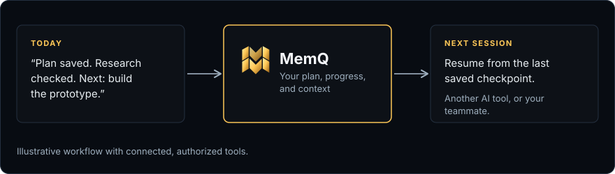

<a href="https://multinex.ai">
  <picture>
    <source media="(prefers-color-scheme: dark)" srcset="https://raw.githubusercontent.com/multinex-ai/.github/master/profile/assets/multinex-lockup-dark.svg">
    
  </picture>
</a>

### Help your AI finish what it starts.

MemQ keeps saved plans, decisions, and checkpoints across sessions, so agents resume complex work instead of restarting it. 
Shield adds local data controls for the prompts, files, and tool calls you connect.

 

  

 

## Two products, one workflow

<table>
<tr>
<td width="50%" valign="top">

### [MemQ](https://multinex.ai/memq/)
**Shared AI memory for work that takes more than one session.**

- **Resume from checkpoints.** Bring the saved plan and open steps into a fresh session.
- **Ground the next step.** Recall decisions and sources, then verify what changed.
- **Carry work across agents.** Continue with another connected tool or an authorized teammate.

Works with Claude Code, Cursor, Codex, and other MCP-compatible clients.

[Explore MemQ](https://multinex.ai/memq/) · [Pricing](https://multinex.ai/memq/pricing/) · [Evidence](https://multinex.ai/benchmarks/memq/)

</td>
<td width="50%" valign="top">

### [Shield](https://multinex.ai/shield/)
**Enterprise AI controls that run on your device.**

- **Check before sending.** Inspect prompts, files, and MCP calls locally.
- **Apply your data rules.** Redact or block sensitive content in configured workflows.
- **Use it with MemQ or alone.** MemQ does not require Shield.

Pair them when you want to share the insight and guard the sensitive data.

[Explore Shield](https://multinex.ai/shield/) · [Governance](https://multinex.ai/governance/) · [Enterprise demo](https://multinex.ai/enterprise/)

</td>
</tr>
</table>

## Start in three steps

| | Step | What you do |
|---|---|---|
| **1** | **Connect your AI tool** | Create a free MemQ account and connect an MCP-compatible client to `https://mcp.multinex.ai/mcp/v1`. |
| **2** | **Save a checkpoint** | Keep the plan, completed steps, evidence, and what remains. |
| **3** | **Resume with context** | In a new session, ask your agent to recall the checkpoint, check current facts, and continue. |

No credit card required. [Create a workspace](https://billing.multinex.ai/signup?product=memq&next=%2Fdashboard%3Fproduct%3Dmemq), then follow the [setup guide](https://multinex.ai/docs/memq/).

## Open source

| Repository | What it is |
|---|---|
| [**memq-connect**](https://github.com/multinex-ai/memq-connect) | MCP Registry manifest and Claude Code plugin for hosted MemQ |
| [**memq-mcp-starter**](https://github.com/multinex-ai/memq-mcp-starter) | Minimal MCP starter for MemQ-backed agents |
| [**memq-cursor-claude-starter**](https://github.com/multinex-ai/memq-cursor-claude-starter) | Starter workflow for Cursor and Claude agent memory |
| [**memq-team-handoff-starter**](https://github.com/multinex-ai/memq-team-handoff-starter) | Team handoff pattern on shared agent memory |
| [**memq-benchmark**](https://github.com/multinex-ai/memq-benchmark) | Reproducible memory, retrieval, and coordination benchmark |
| [**multinex-shield**](https://github.com/multinex-ai/multinex-shield) | Multinex Shield: local AI firewall and prompt guard |
| [**mnx-agi**](https://github.com/multinex-ai/mnx-agi) | Model-agnostic recursive agent harness paired with MemQ |
| [**multinex-skills**](https://github.com/multinex-ai/multinex-skills) | Skills for MemQ memory, Shield protection, and workflows |
| [**agentic-order-triage**](https://github.com/multinex-ai/agentic-order-triage) | Forward-deployed agent reference with isolated tool contracts and evals |

## Find us

[Website](https://multinex.ai) · [Docs](https://multinex.ai/docs/) · [About](https://multinex.ai/about/) · [Architecture](https://multinex.ai/architecture/) · [Sign in](https://billing.multinex.ai/login) · [Status](https://status.multinex.ai) · [Privacy](https://multinex.ai/privacy/) · [Terms](https://multinex.ai/terms/)

  <b>Multinex</b> · AI agent memory with local data controls

